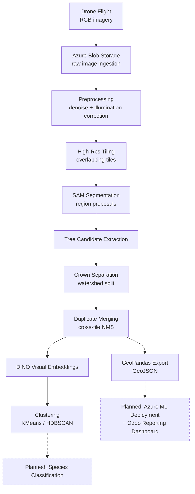

# 🌿 AI-Driven Drone-Based Detection and Mapping of Invasive Species


> **Capstone Project — Portfolio / Demonstration Repository**
> A geospatial computer vision pipeline that detects and maps individual tree
> crowns from high-resolution drone imagery, as a foundation for automated
> invasive species monitoring.

---

## ⚠️ Confidentiality Disclaimer

This is a **sanitized, public portfolio version** of an active capstone
project built under a real institutional engagement. It exists to
demonstrate the **technical approach, system design, and engineering
quality** of the work — it is **not** the original project and does not
contain:

- Real drone imagery, orthomosaics, or derived crops
- The original training/labeled datasets
- Azure connection strings, SAS tokens, or any cloud credentials
- Confidential survey locations, coordinates, or site identifiers
- Any client, institution, or partner-sensitive information

All imagery used in this repository (including in `notebooks/demo_pipeline.ipynb`)
is **procedurally generated synthetic data** (`src/utils/synthetic_data.py`).
All accuracy/performance figures you'd expect from a real evaluation are
**deliberately omitted** — this repo demonstrates *how the system is built*,
not validated results on confidential data.

---

## 📌 Project Objective

Invasive plant species spread quickly, outcompete native vegetation, and are
expensive to monitor manually across large or hard-to-access terrain.
Traditional ground-based surveys don't scale. This project builds an
**AI/computer-vision pipeline that turns drone imagery into individual,
georeferenced tree-crown detections** — the structural foundation needed
before species-level classification and GIS-based monitoring can happen at
scale.

## 🧩 Problem Statement

Given a high-resolution drone orthomosaic of forested or mixed vegetation
terrain, automatically:

1. Detect **individual tree crowns**, not just "vegetation vs. not vegetation."
2. Separate crowns that visually merge together in dense canopy.
3. Produce **georeferenced, deduplicated** detections usable in GIS tools.
4. Group visually similar crowns to support future species identification —
   without requiring a large labeled dataset up front.

This is a harder problem than generic object detection: individual tree
crowns have no rigid shape, canopy overlaps heavily, drone tiles must be
stitched back into one consistent coordinate system, and (critically for
this project's real-world stage) **labeled species data does not yet
exist** — the pipeline has to be useful *before* supervised classification
is possible.

## 🛠️ Technical Approach

Rather than training a single end-to-end detector (which needs labeled data
this project doesn't have yet), the pipeline is deliberately staged around
**zero-shot / self-supervised foundation models**, so useful structure can
be extracted from unlabeled drone imagery today, with supervised
classification layered on top once field-verified labels exist:

1. **Preprocessing** — illumination correction (CLAHE) and denoising to
   normalize varying flight/lighting conditions.
2. **High-resolution tiling** — overlapping tiles keep large orthomosaics
   within segmentation model memory limits.
3. **SAM-based segmentation** — Meta's **Segment Anything Model** generates
   class-agnostic region proposals per tile, with no need for
   task-specific training data.
4. **Tree candidate extraction** — shape/size filtering turns raw masks
   into plausible individual crown candidates.
5. **Crown separation** — watershed-based splitting resolves crowns that
   merge together in dense canopy.
6. **Duplicate merging** — greedy IoU-based NMS resolves the same tree
   being detected in more than one overlapping tile.
7. **Visual embeddings & clustering** — crown crops are embedded with
   **DINO-family self-supervised vision transformers** and grouped with
   KMeans/HDBSCAN, letting a domain expert spot candidate species clusters
   for field verification *before* any labels exist.
8. **Geospatial export** — final detections are converted to a
   **GeoPandas** GeoDataFrame and exported as GeoJSON for GIS tools.

## 🏗️ Architecture



Full breakdown of each stage and the design rationale: [docs/architecture.md](docs/architecture.md) · [docs/workflow.md](docs/workflow.md)

## 📂 Repository Structure

```
invasive-species-ai-poc/
├── README.md
├── LICENSE
├── requirements.txt
├── .gitignore
├── src/
│   ├── preprocessing/    # image normalization + high-res tiling
│   ├── detection/        # candidate extraction, crown separation, dedup
│   ├── segmentation/     # SAM-based mask generation
│   ├── clustering/       # DINO embeddings + unsupervised clustering
│   └── utils/            # synthetic data, geo export, visualization, config
├── notebooks/
│   └── demo_pipeline.ipynb   # end-to-end run on synthetic data
├── sample_data/
│   └── README.md         # explains why no real imagery is included
├── docs/
│   ├── architecture.md
│   └── workflow.md
└── outputs/
    └── README.md
```

## 🚀 Setup & Execution

```bash
# 1. Clone and enter the repo
git clone https://github.com/Varun072006/invasive-species-ai-poc.git
cd invasive-species-ai-poc

# 2. Create a virtual environment
python -m venv .venv
.venv\Scripts\activate      # Windows
# source .venv/bin/activate  # macOS/Linux

# 3. Install dependencies
pip install -r requirements.txt

# 4. Launch the demo notebook
jupyter notebook notebooks/demo_pipeline.ipynb
```

The demo notebook runs **fully offline on synthetic data** — no Azure
account, GPU, or downloaded model weights are required. To run the
production-grade segmentation/embedding models instead of the lightweight
demo fallbacks:

```bash
pip install segment-anything
# download a SAM checkpoint (e.g. sam_vit_b_01ec64.pth) from Meta's repo,
# then in src/segmentation/sam_segmentation.py set USE_MOCK_SEGMENTER = False
# and instantiate SamCrownSegmenter(checkpoint_path="path/to/checkpoint.pth")
```

DINO embeddings are loaded on demand via `torch.hub` — set
`USE_MOCK_EMBEDDER = False` in `src/clustering/visual_embeddings.py` to use
them instead of the demo's lightweight color/texture descriptor.

To connect to your **own** Azure Blob Storage account (never commit real
credentials), set environment variables before running:

```bash
export AZURE_STORAGE_ACCOUNT_URL="https://<your-account>.blob.core.windows.net"
export AZURE_STORAGE_CONTAINER="<your-container>"
export AZURE_STORAGE_SAS_TOKEN="<your-sas-token>"
```

## 📊 Project Status & Roadmap

This is an **active, in-progress capstone project**. Status below reflects
where things genuinely stand — no results are overstated:

| Stage | Status |
|---|---|
| Drone data ingestion via Azure Blob Storage | ✅ Implemented (production pipeline) |
| Preprocessing & high-resolution tiling | ✅ Implemented |
| SAM-based segmentation | ✅ Implemented (integration-ready; demo uses a lightweight CV fallback) |
| Tree candidate extraction, crown separation, duplicate merging | ✅ Implemented |
| Visual embeddings & exploratory clustering | ✅ Implemented (experimental) |
| High-quality labeled field dataset | 🔄 In progress — awaiting additional survey data |
| Supervised species classification | 🔜 Planned, blocked on labeled data above |
| Full model deployment to Azure (ML / Container Instances) | 🔜 Planned |
| Odoo integration for field-ops & stakeholder reporting | 🔜 Planned |
| GIS mapping dashboard | 🔜 Planned |

## 👤 My Role & Contributions

As the sole engineer on this capstone project, I:

- Designed the end-to-end system architecture, from raw drone image
  ingestion through to GIS-ready detection export.
- Implemented the full computer vision pipeline: preprocessing, tiling,
  SAM-based segmentation integration, tree candidate extraction, watershed
  crown separation, and cross-tile duplicate merging.
- Built the exploratory clustering workflow (DINO embeddings + KMeans/HDBSCAN)
  used to surface visually distinct crown groups ahead of supervised
  species labeling.
- Set up the Azure Blob Storage-based data ingestion path and structured the
  codebase for a future Azure ML deployment.
- Authored this sanitized public version, including the synthetic data
  generator, so the technical approach can be demonstrated and discussed
  without exposing confidential project data.

## 🧰 Technologies Used

| Category | Technologies |
|---|---|
| Language | Python 3.10+ |
| Computer Vision | OpenCV, scikit-image |
| Deep Learning | PyTorch, Segment Anything (SAM), DINO self-supervised embeddings (torch.hub) |
| Machine Learning | scikit-learn, HDBSCAN |
| Geospatial | GeoPandas, Shapely |
| Cloud | Azure Blob Storage (data ingestion); Azure ML-compatible deployment path (planned) |
| Planned Integration | Odoo (field-ops / stakeholder reporting dashboard) |
| Tooling | Jupyter, NumPy, pandas, Matplotlib |

## 🧗 Challenges Discovered

- **Dense canopy overlap** — a single SAM mask frequently covers more than
  one physical tree crown, motivating the watershed-based crown separation
  step rather than treating every mask as one tree.
- **Tile-boundary duplication** — overlapping tiles (needed to avoid
  cutting a crown in half) reliably produce duplicate detections near tile
  seams, requiring a scene-coordinate NMS pass rather than per-tile
  deduplication.
- **No labeled species data at this stage** — this ruled out a direct
  supervised-classification approach early on and is the reason the
  pipeline is built around zero-shot segmentation (SAM) and self-supervised
  embeddings (DINO) instead: they produce useful structure without labels,
  while the field dataset needed for classification is still being
  collected.
- **Illumination variance across a single flight** — shifting sun angle and
  cloud cover across a survey area made a fixed brightness/contrast
  assumption unreliable, motivating adaptive (CLAHE-based) correction over
  a global normalization.

## 🔭 Future Improvements

- Train a supervised species classifier once sufficient field-verified
  labeled data is available, using the clustering output to prioritize
  which groups to label first.
- Complete deployment of the segmentation/embedding models to **Azure**
  (Azure ML or Container Instances) for scalable batch inference over full
  survey flights.
- Integrate **Odoo** for field-operations scheduling and stakeholder-facing
  detection reporting.
- Add a temporal dimension — compare detections across repeated flights of
  the same area to track invasive species spread over time.
- Build a lightweight GIS-based web dashboard on top of the exported
  GeoJSON detections.

## 📄 License

Code in this repository is released under the [MIT License](LICENSE). This
license does **not** extend to third-party pretrained model weights
(Segment Anything, DINO) or to any original confidential project data,
neither of which is included here.

---

<sub>This repository is a sanitized technical demonstration built for a
public portfolio. It reflects the architecture and engineering approach of
an active capstone project, not its confidential dataset or results.</sub>
