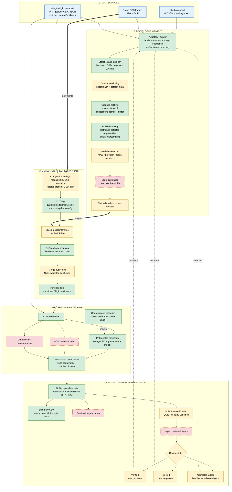

# Pipeline diagram (matches the code as of 2026-11-03)

Colour = implementation status. Green: built and tested. Yellow: partly built. Red dashed: planned, not built.
"Built and tested" means unit tests and real-frame smoke tests with synthetic labels; no model has been trained yet.
Preview in VS Code with a Mermaid extension, or paste into https://mermaid.live.

## Status notes

| Box | State | Detail |
|---|---|---|
| A, QA, SPL | built | `build_dataset.py`, `stats.py`; spatial-block folds exist because consecutive frames overlap 60-80% |
| TRN | built, never run | `train.py` wraps Ultralytics (AGPL licence); no labels or weights exist yet |
| VER | partial | hash of the export and a `dataset_meta.json`; no manifest hash or dataset registry |
| EVAL | partial | `metrics.py` (AP50, precision, recall, F1) exists; no evaluation script wires it to a held-out fold |
| CAL | planned | thresholds are fixed values in `configs/default.yaml` until calibrated on validation data |
| MODEL | partial | the weights path is stored as the model version; no registry |
| C | partial | corrupt/incomplete file detection, EXIF orientation, geotag presence done; blur check not done; GSD is computed in `stats.py` only |
| D | built | tile covers `tile_px / scale` source pixels; the scale is not decided yet (needs real box sizes) |
| INF | partial | batched inference works through the detector wrapper; FP16 is not enabled explicitly |
| NMS | partial | class-aware NMS only; weighted box fusion not implemented |
| TIER | built | thresholds are uncalibrated placeholders |
| PPK | built | validated by overlap: HARC 0.77 m, DPP EO 0.49 m median disagreement; not checked against field points |
| ODM, MOS | planned | need photogrammetry output or an orthomosaic |
| DEDUP, G, SUM | built | area is the footprint of detection boxes, not canopy cover |
| PREV | planned | preview images and map |
| H, IMP, DEC | external / planned | reviewers work in QGIS, QField or Labelbox; the `status` column exists, but no code reads reviewed results back |
| Feedback loop | planned | verified becomes positives, rejected becomes hard negatives, corrected becomes fixed labels, all re-entering at A |

## Changes from the earlier diagram

1. Labelbox feeds only the dataset builder (it was wired into inference).
2. New flights enter at ingestion; the trained model feeds inference as weights.
3. Added the third input, Wingtra PPK geotags. EXIF has no GPS, so "EXIF flat projection" is replaced by PPK geotag projection.
4. Added the georeference validation step.
5. All three review outcomes feed back; "candidate" is the initial status before review.
6. Removed the unexplained outer loop line.
7. Boxes are marked built, partial or planned instead of implying everything exists.
