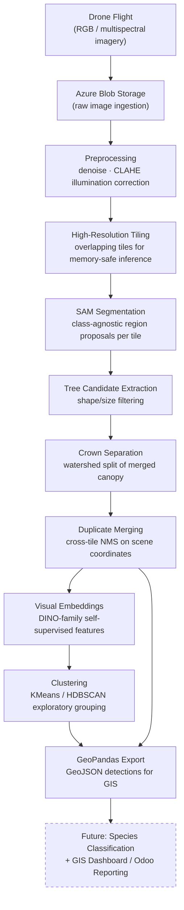

# System Architecture

> This document describes the technical architecture of the AI-Driven
> Drone-Based Detection and Mapping of Invasive Species system. It reflects
> the design approach and current implementation status — see
> [README.md](../README.md) for the confidentiality disclaimer and project
> status summary.

## Component overview

## Layer-by-layer breakdown

### 1. Data ingestion (Azure)
Drone survey imagery is captured in the field and uploaded to a private
Azure Blob Storage container. `src/utils/config.py` defines an
`AzureBlobConfig` that reads connection parameters purely from environment
variables — no credentials are ever hardcoded or committed. When no Azure
environment is configured, every module in this repo falls back to
synthetic data so the pipeline remains fully runnable offline.

### 2. Preprocessing (`src/preprocessing/`)
Raw tiles are denoised and contrast-normalized (CLAHE on the LAB luminance
channel) to compensate for varying sun angle and haze across a flight, then
split into overlapping tiles sized to fit segmentation model memory limits.

### 3. Segmentation (`src/segmentation/`)
Each tile is passed through Meta's **Segment Anything Model (SAM)**
automatic mask generator to produce class-agnostic region proposals. A
lightweight classical-CV fallback segmenter is included so the public demo
runs without downloading SAM checkpoint weights.

### 4. Detection (`src/detection/`)
Raw masks are filtered into plausible tree-crown candidates by size and
circularity, dense canopy blobs are split via watershed-based crown
separation, and duplicate detections arising from tile overlap are resolved
with a greedy IoU-based merge pass in full-scene coordinates.

### 5. Clustering (`src/clustering/`)
Individual crown crops are embedded using **DINO-family self-supervised
vision transformers** (loaded via `torch.hub`) and grouped with KMeans /
HDBSCAN. This is an exploratory step: before labeled species data exists,
clustering surfaces visually distinct groups (e.g. a candidate invasive
species standing apart from native canopy) for expert review.

### 6. Geospatial export (`src/utils/geo_utils.py`)
Detections are converted into a `GeoDataFrame` and exported as GeoJSON,
ready to load into QGIS, ArcGIS, or a web mapping stack.

### 7. Planned: cloud deployment & reporting
- **Azure ML / Container Instances** — scale inference beyond a local
  machine; model artifacts and endpoints are not yet finalized.
- **Odoo integration** — planned for field-operations and stakeholder
  reporting (e.g. survey scheduling, detection summaries, client-facing
  dashboards) once the detection pipeline stabilizes. Not yet implemented.

## Why this architecture

- **Tiling before segmentation** avoids OOM on gigapixel orthomosaics while
  keeping SAM's proposal quality high on each manageable tile.
- **Class-agnostic segmentation before classification** lets the system
  detect *that* something is a tree crown without yet needing labeled
  species data — species ID is layered on top once labels exist.
- **Clustering before classification** turns an unlabeled dataset into a
  tool for guided labeling: a domain expert reviews clusters instead of
  every individual detection.
- **Cloud-compatible, not cloud-locked** — Azure is the current target, but
  ingestion/config is abstracted so the core CV pipeline isn't tied to one
  provider.
